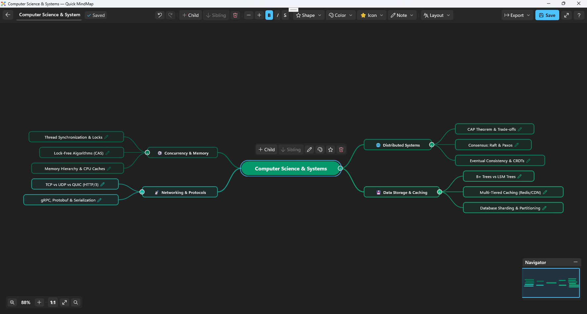

# QuickMindMap

<p align="center">
  <strong>Fast, fluid, and intuitive visual brainstorming &amp; knowledge mapping for Windows.</strong>
</p>

<p align="center">
  <a href="https://github.com/uponatime2019/QuickMindMap/releases/latest"></a>
  
  
  
  <a href="LICENSE"></a>
</p>

---

## ⚡ Try It Now (Portable Zero-Install)

No installer, no administrative privileges, and no background runtime installation required. Simply download, unzip, and launch!

👉 **[Download the Latest Standalone Portable Release (.zip)](https://github.com/uponatime2019/QuickMindMap/releases/latest)**

1. Download `QuickMindMap-*-win-x64.zip` from the latest release.
2. Extract the archive anywhere on your machine.
3. Launch `QuickMindMap.exe` to start mapping immediately!

---

## 📸 Application Preview



---

## ✨ Key Features

- **Intuitive Visual Hierarchy**: Build comprehensive concept maps starting with a central topic and branching seamlessly into child and sibling ideas.
- **Smart Automatic Layout**: Dynamic layout algorithms arrange topics with graceful Bézier curved connectors, maintaining clean visual balance.
- **Rich Library Management**:
  - Grid view of all locally saved maps with node counts, category badges, and modification dates.
  - Instant sorting by **Name (A-Z)**, **Category Group**, or **Recent Activity**.
  - Real-time search filtering by title, group, or keyword.
- **Ready-to-Use Templates**:
  - 🧠 *Brainstorming* (Ideas, causes, creative solutions)
  - 🚀 *Project Planning* (Milestones, phases, scope, deliverable tasks)
  - 📚 *Study & Exam Notes* (Core concepts, definitions, formulas)
  - ⚖️ *Pros & Cons Analysis* (Balanced decision making)
  - 📋 *Meeting Notes* (Agendas, discussions, action items)
  - ✨ *Blank Canvas* (Freeform thinking)
- **Deep Editing Experience**:
  - Inline editing with automatic sizing.
  - Branch expansion and collapse for managing large-scale trees.
  - Multi-level Undo & Redo stack (`Ctrl+Z` / `Ctrl+Y`).
  - Customizable color palettes (Vivid Spectrum, Emerald Nature, Warm Sunset, Ocean Gradient, Monochrome Minimal).
- **Flexible Import & Export**:
  - **PNG Image**: Export high-resolution captures of the canvas for presentations and documentation.
  - **Markdown (`.md`)**: Export to and import from hierarchical Markdown lists.
  - **OPML (`.opml`)**: Seamless compatibility with outline editors and knowledge-base tools.
  - **JSON (`.m8map`, `.json`)**: Structured, human-readable document interchange.
  - **Plain Text (`.txt`)**: Clean indented tree outlines.
- **Pure Desktop Native**: 100% unpackaged WinUI 3 standalone executable utilizing Windows 11 Mica backdrop, dark/light theme integration, and Per-Monitor V2 DPI awareness.

---

## ⌨️ Keyboard Shortcuts & Controls

QuickMindMap is engineered for high-speed, keyboard-driven mind mapping:

| Shortcut | Action | Description |
| :--- | :--- | :--- |
| `Tab` / `Insert` | **Add Child** | Create a sub-topic under the selected node |
| `Enter` | **Add Sibling** | Create a new topic at the same hierarchy level |
| `F2` / `Double Click` | **Edit Text** | Begin inline text editing for the selected node |
| `Delete` / `Backspace` | **Delete Branch** | Delete the selected topic and all its descendants |
| `Spacebar` | **Toggle Branch** | Collapse or expand children of the selected node |
| `Arrow Keys` | **Navigate** | Move focus between parent, children, and sibling nodes |
| `Ctrl + Z` | **Undo** | Revert the last canvas or text modification |
| `Ctrl + Y` | **Redo** | Reapply the previously undone action |
| `Ctrl + 0` | **Reset Zoom** | Reset the canvas magnification to 100% |
| `Mouse Wheel` | **Zoom** | Smoothly zoom in and out around the cursor |
| `Drag Canvas` | **Pan** | Move freely across the infinite canvas |
| `Drag Node` | **Reposition** | Move nodes in freeform space |
| `F11` | **Fullscreen** | Toggle borderless fullscreen view |

---

## 🏗️ Architecture & Technology Stack

- **UI Framework**: [WinUI 3](https://learn.microsoft.com/windows/apps/winui/winui3/) via [Windows App SDK 1.6+](https://learn.microsoft.com/windows/apps/windows-app-sdk/)
- **Runtime**: [.NET 8.0](https://dotnet.microsoft.com/download/dotnet/8.0) (`net8.0-windows10.0.19041.0`)
- **Language**: C# 12 (Nullable reference types enabled)
- **Deployment Model**: Standalone unpackaged (`<WindowsPackageType>None</WindowsPackageType>`), self-contained single-folder release with zero runtime MSIX dependencies.
- **Serialization**: [Newtonsoft.Json](https://www.nuget.org/packages/Newtonsoft.Json) for structured `.m8map` / JSON persistence.
- **Rendering & Composition**: Native XAML Shape Canvas elements with Bézier curves, hardware-accelerated transforms, and `RenderTargetBitmap` image export.

---

## 🛠️ Building & Running from Source

### Prerequisites
- Windows 10 (version 1809+) or Windows 11
- [.NET 8.0 SDK](https://dotnet.microsoft.com/download/dotnet/8.0)
- [Visual Studio 2022](https://visualstudio.microsoft.com/vs/) (v17.8 or later) with:
  - *.NET Desktop Development* workload
  - *Windows App SDK C# Templates*

### Build via Command Line
```powershell
# Clone the repository
git clone https://github.com/uponatime2019/QuickMindMap.git
cd QuickMindMap

# Build Debug x64
dotnet build QuickMindMap.csproj -p:Platform=x64

# Run Unpackaged App
dotnet run --project QuickMindMap.csproj
```

### Self-Contained Release Publish
To build a portable zero-install directory:
```powershell
dotnet publish QuickMindMap.csproj -c Release -p:Platform=x64 -o publish/QuickMindMap_Portable
```

---

## 🗺️ Project Roadmap

- [x] Unpackaged WinUI 3 standalone architecture
- [x] Mica backdrop & Windows 11 fluent design system
- [x] Infinite canvas with smooth panning and zooming
- [x] Multi-tier templates (Brainstorming, Project Planning, Study Notes)
- [x] Multi-format export (PNG, Markdown, OPML, JSON, Text)
- [x] Markdown file import & tree generator
- [ ] Multi-branch drag-and-drop hierarchy re-parenting
- [ ] Rich text styling (Bold, Italic, Strikethrough) within nodes
- [ ] Tagging & icon badges on individual nodes
- [ ] SVG vector export format support
- [ ] Cloud sync / auto-backup options (OneDrive, Local Folder)
- [ ] ARM64 native binary builds

---

## 🤝 Contributing

Contributions, bug reports, and feature suggestions are warmly welcomed!
Check out our [CONTRIBUTING.md](CONTRIBUTING.md) guide for details on submitting issues and pull requests.

If you find QuickMindMap helpful, give it a ⭐️ on GitHub!

---

## 📄 License

This project is licensed under the [MIT License](LICENSE).
